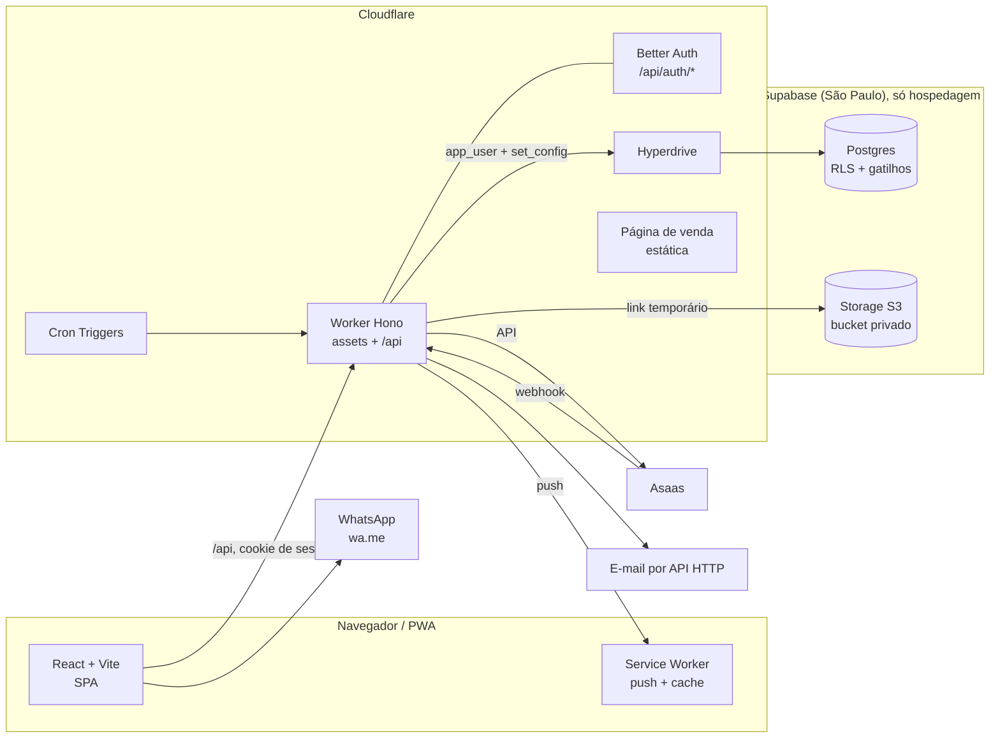

# Arquitetura do software

Central do Correspondente · versão 0.2 · 15/11/2026 (revista com o design da fase 1: Better Auth e Worker como API)

## 1. Visão geral

**Princípio:** o navegador só fala com o Worker (`/api`), na mesma origem e com cookie de sessão do Better Auth. Toda rota de domínio roda numa transação como `app_user`, com `set_config('app.usuario_id', <id da sessão>, true)`, e quem decide o acesso é a RLS do Postgres (`withUser`). O papel `app_system` (que ignora a RLS) fica restrito ao Better Auth, ao cadastro de escritório, ao aceite de convite e a rotinas do sistema que recebem a conta explícita.

## 2. Componentes

### 2.1 Front-end (SPA)

- **React + Vite + TypeScript**, servido como assets estáticos pelo Worker.
- Roteamento no cliente (React Router). Cache e sincronização com TanStack Query: sem tempo real, as listas atualizam ao voltar para a aba, depois de gravar e a cada 30 s (D-32).
- Cliente do Better Auth (`better-auth/react`) só para sessão: entrar, sair, confirmar e-mail, recuperar senha.
- **Zod** para validar formulários (CPF/CNPJ, telefone, e-mail) com os mesmos esquemas usados pelo Worker (`src/regras/esquemas.ts`).
- `src/regras/`: funções puras das regras de exibição (ativo, parado, situação da cobrança, mensagens de WhatsApp, documentos, planos). Testadas com Vitest.
- Visual: Tailwind v4 + shadcn/ui com tokens claro/escuro em variáveis CSS; as telas da fase 2 são desenhadas sobre esses tokens (não há protótipo, D-24).
- **PWA:** manifest, ícones e service worker (cache do app + recebimento de push).
- Redução de fotos acima de 2,5 MB no navegador (canvas → JPG 2.200 px). HEIC precisa de conversão por biblioteca no navegador, porque só o Safari decodifica HEIC nativamente.
- Relatório de VGV: planilha (.xlsx) e PDF gerados no navegador a partir da view de remuneração, só para o gestor.

### 2.2 Cloudflare Worker (`worker/`)

Um único Worker (Hono) serve a SPA e expõe a API inteira. A cada pedido ele abre as conexões pelo Hyperdrive (`DB_APP` como `app_user`, `DB_SYSTEM` como `app_system`), lê a sessão do Better Auth e fecha as conexões depois da resposta.

| Rota | Função | Fase |
|---|---|---|
| `/api/auth/*` | Better Auth: entrar, sair, confirmar e-mail, recuperar senha | 1 |
| `POST /api/cadastro` | Cadastro aberto de escritório (conta nasce `pendente`) | 1 |
| `GET /api/eu` | Usuário da sessão e os escritórios em que é membro ativo | 1 |
| `GET /api/contas/:contaId/equipe` | Membros e convites pendentes | 1 |
| `POST /api/contas/:contaId/convites` | Convidar funcionária/corretor; o banco aplica o limite do plano (RN-18) | 1 |
| `POST /api/contas/:contaId/convites/:id/reenviar` · `DELETE …/convites/:id` | Reenviar (token novo) e cancelar convite | 1 |
| `POST /api/contas/:contaId/membros/:id/desativar` | Desativar acesso (a linha fica) | 1 |
| `GET /api/convites/:token` · `POST /api/convites/:token/aceitar` | Ver e aceitar convite (públicas) | 1 |
| `GET /api/arquivos/:id/link` | Confere permissão, grava auditoria, devolve link temporário (até 5 min) | 2 |
| `POST /api/push/inscrever` | Salvar inscrição de push do aparelho | 4 |
| `POST /api/assinatura` | Criar cliente e assinatura no Asaas no valor do plano (gestor) | 4 |
| `POST /api/assinatura/plano` | Trocar de plano: atualiza o valor no Asaas e `contas.plano`; ao voltar para o Simples, desativa funcionária e corretores antes de mudar o plano (gestor) | 4 |
| `POST /api/webhooks/asaas` | Receber eventos de pagamento (token do webhook) | 4 |

O `usuarioId` vem sempre da sessão, nunca do corpo do pedido. O escritório ativo vem na URL; trocar o id não abre nada, porque a RLS confere por linha a participação em `membros`.

**Cron Triggers** (horários em Brasília; o cron da Cloudflare roda em UTC):

| Quando | Rotina |
|---|---|
| Diário 8h (11h UTC) | Lembrete das cobranças do dia: push + e-mail para G e F de cada conta ativa |
| Diário 3h (6h UTC) | Exclusão programada de anexos (aviso no dia 25, exclusão no dia 30) |
| Diário 4h (7h UTC) | Conferir contas em atraso há mais de 7 dias → suspensa |

### 2.3 Banco (Postgres) e arquivos

- **Postgres 18**, schema em `db/migrations` (dbmate), versionado no repositório. Detalhes em [MODELO-DE-DADOS.md](MODELO-DE-DADOS.md).
- **Papéis:** o dono (migrations e comando `conta:liberar`), `app_user` (sem `BYPASSRLS`, todas as rotas de domínio) e `app_system` (`BYPASSRLS`, só os casos do §1).
- **RLS em todas as tabelas de domínio**, com funções auxiliares (`meu_usuario_id`, `meu_perfil`, `meu_corretor_id`, `conta_ativa`, `hoje_br`) que leem `app.usuario_id`.
- **Gatilhos** para as regras de integridade: RN-06, RN-07, RN-11, RN-12, RN-18 (limite do plano), RF-23 (anexo marca recebido), histórico de etapa, auditoria de alterações.
- **Views** de remuneração (RN-08 a RN-10) que só devolvem linhas ao gestor.
- **Login:** Better Auth 1.7.16 nas tabelas dele (`user`, `session`, `account`, `verification`, `rateLimit`), acessadas como `app_system`. Escritórios, membros e convites são tabelas nossas (D-31).
- **Storage (fase 2):** bucket `documentos` privado no Supabase Storage via API S3 (dados no Brasil). Caminho `conta_id/cliente_id/arquivo_id.ext`. Upload e download só pelo Worker, com link temporário.
- **Produção:** Supabase em São Paulo, plano pago (o gratuito pausa por inatividade); backup diário incluso. Conferir o preço atual antes da fase 4. O Worker chega ao banco pelo Hyperdrive.

## 3. Multi-escritório e perfis

- Toda tabela de negócio tem `conta_id`.
- `membros` liga usuário ↔ conta ↔ perfil, com `status` (`ativo` ou `desativado`). O corretor também tem `corretor_id`, que o liga ao cadastro de corretor daquela conta.
- O escritório ativo vem na URL e o navegador guarda o último usado; a RLS impede ler qualquer conta da qual a pessoa não é membro ativo, mesmo que o id seja adulterado.
- Convite: token no link, só o hash no banco, validade de 7 dias; o aceite (`aceitar_convite`) confere validade e e-mail e cria o membro.
- Limites por plano (RN-18): no Simples, só o gestor; no Com corretores, 1 gestor e 1 funcionária ativos e corretores ilimitados. Índice único parcial (1 gestor, 1 funcionária) + gatilhos `tg_limite_plano` em `membros` e `tg_limite_convite` em `convites` (convite pendente de funcionária conta no limite).
- Como a RLS só reconhece membros ativos, desativar funcionária e corretores na volta para o Simples já corta o acesso deles, sem apagar nada.

## 4. Segurança e LGPD

| Requisito | Como |
|---|---|
| Cada usuário só lê a própria conta | RLS por `conta_id` via `membros`, com o usuário vindo da sessão por `set_config` |
| Funcionária e corretor não veem receita | Percentual em `contas_config` e remuneração em `clientes_remuneracao`, com RLS só do gestor; views de VGV só do gestor |
| Corretor só vê os seus | RLS por `clientes.corretor_id = meu_corretor_id(conta_id)` |
| Campos de cobrança da conta | `plano`, `status_assinatura` e `ativa_ate` sem permissão de update para `app_user` |
| Arquivos privados | Bucket privado, link temporário pelo Worker |
| Registro de quem abriu, alterou ou baixou | Tabela `auditoria`: alterações por gatilho; abertura da ficha por RPC `registrar_visualizacao`; download pelo Worker |
| Termos antes do uso | `termosVersao` e `termosAceitosEm` no usuário, gravados no cadastro e no aceite de convite |
| Prazo dos anexos | Rotina diária (RN-14) |
| Backup diário | Backup do plano pago do Supabase + exportação da conta pelo gestor |
| Dados no Brasil | Postgres e Storage no Supabase em São Paulo |
| Segredos | CriptEnv (D-35): no container de desenvolvimento por `criptenv run`; em produção, segredos do Worker gravados a partir do CriptEnv. Nunca `.env` com valores no disco nem no repositório |
| Abuso no cadastro aberto | Limite de tentativas do Better Auth guardado no banco; Turnstile se aparecer spam |

Papel na LGPD: a correspondente é a **controladora** dos dados dos clientes dela; nós somos **operadores**. Os termos precisam dizer isso, e também que os dados são compartilhados com o corretor que indicou o cliente.

## 5. Integrações

### Asaas
- Na assinatura: criar o cliente (customer) com CPF/CNPJ do gestor e uma assinatura mensal no valor do plano (R$ 99,00 ou R$ 149,00); guardar os ids na conta.
- Troca de plano: atualizar o valor da assinatura existente, sem criar outra. Conferir na documentação do Asaas como aplicar o valor novo só às próximas faturas, sem mexer na fatura já gerada (D-30).
- Webhook em `/api/webhooks/asaas`, autenticado pelo token configurado no painel do Asaas.
- Eventos de pagamento confirmado/recebido → `ativa`; vencido → `em_atraso`. Conferir os nomes exatos dos eventos na documentação do Asaas.
- Idempotência: cada evento é gravado em `eventos_asaas` pelo id; evento repetido é ignorado.
- Ambiente sandbox do Asaas em desenvolvimento.

### WhatsApp
- Só link `wa.me/55<ddd><número>?text=...`. Sem API oficial na v1.

### Push
- Web Push padrão (VAPID). Chaves VAPID como segredo do Worker; envio com biblioteca compatível com o runtime dos Workers (WebCrypto).
- Inscrições em `push_inscricoes`; inscrição expirada (resposta 404/410) é apagada.

### E-mail
- O Worker não usa SMTP: envia por API HTTP, num módulo só. Local: API de envio do Mailpit (`EMAIL_API_URL`). Produção: Resend (D-38), escolhida pela presença de `EMAIL_API_KEY`.
- E-mails da fase 1: confirmação de cadastro, recuperação de senha, convite e aviso de conta existente.

## 6. Ambientes e entrega

| Ambiente | Front + Worker | Banco | E-mail | Asaas |
|---|---|---|---|---|
| Local | `pnpm docker:up`: container do app com `vite dev` (plugin da Cloudflare) | Postgres 18 em container | Mailpit | Sandbox |
| Testes e CI | Vitest no host e Playwright | Postgres 18 (`cc_test`, `cc_e2e`) | Mailpit | — |
| Produção (a partir da fase 3) | Cloudflare Workers | Supabase (São Paulo) via Hyperdrive | Resend (D-38) | Produção |

- Tudo em desenvolvimento roda em Docker (`compose.yaml`: Postgres, Mailpit, s3mock e o app), com os segredos do ambiente `development` do CriptEnv. Portas: app 3002, Postgres 5435, Mailpit 1028/8028, s3mock 9093. Detalhes em [SEGREDOS.md](SEGREDOS.md).
- GitHub Actions: jobs `app` (lint, tipos, unidade), `db` (RLS, gatilhos e rotas contra Postgres) e `e2e` em todo PR. O deploy entra antes do uso real da fase 3.
- Migrations sempre pelo repositório; nada de alterar o schema pelo painel em produção.
- Um ambiente de homologação pode ser criado na fase 3, se o uso real pedir.

## 7. Testes

| Camada | O quê |
|---|---|
| Regras (Vitest) | Ativo, parado, cobrança, percentual usado, remuneração, cota, mensagens |
| Gatilhos (SQL) | RN-06, RN-07, RN-11, RN-12, RN-18 (conta Simples recusa funcionária e corretor), anexo marca recebido |
| RLS (SQL) | Para cada perfil e para um usuário de outra conta: o que lê e o que grava em cada tabela. Inclui "funcionária não lê `clientes_remuneracao`" e "corretor não lê cliente de outro corretor" |
| Rotas do Worker (Vitest) | Cadastro, convites, equipe e sessão contra o banco de teste |
| Ponta a ponta (Playwright) | Fase 1: cadastro → liberação → convite → aceite. Rotina diária nas fases 2 e 3 |

## 8. Decisões que valem rever no futuro

- API oficial do WhatsApp, se o envio automático virar necessidade.
- Login de imobiliária.
- Planos por usuário, se aparecer escritório com mais funcionárias.
- Mover o banco para infraestrutura própria, se o custo do Supabase pesar.
