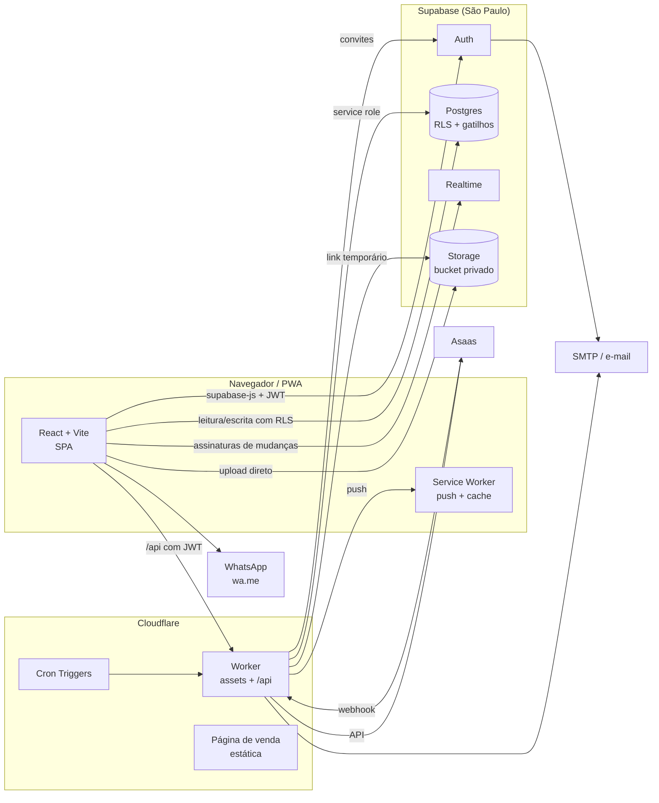

# Arquitetura do software

Central do Correspondente · versão 0.1 · 13/11/2026

## 1. Visão geral

**Princípio:** o navegador fala direto com o Supabase para quase tudo, e a segurança é garantida pela RLS no Postgres. O Worker só faz o que exige chave de serviço ou segredo: convites, links de download auditados, webhook e API do Asaas, push e rotinas agendadas.

## 2. Componentes

### 2.1 Front-end (SPA)

- **React + Vite + TypeScript**, servido como assets estáticos pelo Worker.
- Roteamento no cliente (React Router). Cache e sincronização de dados com TanStack Query.
- `supabase-js` para Auth, consultas, Realtime e upload.
- **Zod** para validar formulários (CPF, telefone, e-mail) com as mesmas regras do banco.
- `src/regras/`: funções puras das regras de exibição (ativo, parado, situação da cobrança, montagem das mensagens de WhatsApp). Testadas com Vitest.
- Visual e CSS reaproveitados do protótipo, com tema claro/escuro por variáveis CSS.
- **PWA:** manifest, ícones e service worker (cache do app + recebimento de push).
- Redução de fotos acima de 2,5 MB no navegador (canvas → JPG 2.200 px). HEIC precisa de conversão por biblioteca no navegador, porque só o Safari decodifica HEIC nativamente.
- Relatório de VGV: planilha (.xlsx) e PDF gerados no navegador a partir da view de remuneração, só para o gestor.

### 2.2 Cloudflare Worker (`worker/`)

Um único Worker serve a SPA e expõe:

| Rota | Função | Auth |
|---|---|---|
| `POST /api/convites` | Convidar funcionária/corretor; aplica o limite do plano (RN-18) | JWT do usuário |
| `POST /api/convites/:id/reenviar` | Reenviar convite | JWT |
| `GET /api/arquivos/:id/link` | Confere permissão, grava auditoria, devolve link temporário (até 5 min) | JWT |
| `POST /api/push/inscrever` | Salvar inscrição de push do aparelho | JWT |
| `POST /api/assinatura` | Criar cliente e assinatura no Asaas no valor do plano | JWT (gestor) |
| `POST /api/assinatura/plano` | Trocar de plano: atualiza o valor da assinatura no Asaas e `contas.plano`; ao voltar para o Simples, desativa funcionária e corretores antes de mudar o plano | JWT (gestor) |
| `POST /api/webhooks/asaas` | Receber eventos de pagamento | Token do webhook |
| `POST /api/importar` | Importar JSON do protótipo | JWT (gestor) |

O Worker valida o JWT do Supabase em toda chamada autenticada e, para conferir permissão, consulta o banco **como o próprio usuário** (repassando o JWT), de modo que a RLS decide. A chave de serviço só é usada depois da checagem.

**Cron Triggers** (horários em Brasília; o cron da Cloudflare roda em UTC):

| Quando | Rotina |
|---|---|
| Diário 8h (11h UTC) | Lembrete das cobranças do dia: push + e-mail para G e F de cada conta ativa |
| Diário 3h (6h UTC) | Exclusão programada de anexos (aviso no dia 25, exclusão no dia 30) |
| Diário 4h (7h UTC) | Conferir contas em atraso há mais de 7 dias → suspensa |

### 2.3 Supabase

- **Postgres:** schema em `supabase/migrations`, versionado no repositório. Detalhes em [MODELO-DE-DADOS.md](MODELO-DE-DADOS.md).
- **RLS em todas as tabelas**, com funções auxiliares (`meu_perfil`, `meu_corretor_id`, `conta_ativa`).
- **Gatilhos** para as regras de integridade: RN-06, RN-07, RN-11, RN-12, RN-18 (limite do plano), RF-23 (anexo marca recebido), histórico de etapa, auditoria de alterações.
- **Views** de remuneração (RN-08 a RN-10) acessíveis só ao gestor.
- **Auth:** e-mail e senha, convite e recuperação. SMTP próprio em produção (o SMTP padrão do Supabase tem limite baixo de envio).
- **Storage:** bucket `documentos` privado. Caminho `conta_id/cliente_id/arquivo_id.ext`. Política de upload por perfil e por cliente; **sem política de leitura direta**: download só via Worker.
- **Realtime:** `postgres_changes` em `clientes`, `documentos`, `arquivos` e `historico`, respeitando RLS.
- **Plano pago em produção** (o gratuito pausa por inatividade); backup diário incluso. Conferir o preço atual antes da fase 4.

## 3. Multi-escritório e perfis

- Toda tabela de negócio tem `conta_id`.
- `membros` liga usuário ↔ conta ↔ perfil. O corretor também tem `corretor_id`, que o liga ao cadastro de corretor daquela conta.
- O front guarda o escritório escolhido e filtra por `conta_id`; a RLS impede ler qualquer conta da qual a pessoa não é membro, mesmo que o filtro seja adulterado.
- Limites por plano (RN-18): no Simples, só o gestor; no Com corretores, 1 gestor e 1 funcionária ativos e corretores ilimitados. Índice único parcial (1 gestor, 1 funcionária) + gatilho `tg_limite_plano` em `membros`, que recusa funcionária e corretor em conta Simples.
- Como a RLS só reconhece membros ativos, desativar funcionária e corretores na volta para o Simples já corta o acesso deles, sem apagar nada.

## 4. Segurança e LGPD

| Requisito | Como |
|---|---|
| Cada usuário só lê a própria conta | RLS por `conta_id` via `membros` |
| Funcionária e corretor não veem receita | Percentual e remuneração em tabela separada (`clientes_remuneracao`) com RLS só do gestor; views de VGV só do gestor |
| Corretor só vê os seus | RLS por `clientes.corretor_id = meu_corretor_id(conta_id)` |
| Arquivos privados | Bucket privado, link temporário pelo Worker |
| Registro de quem abriu, alterou ou baixou | Tabela `auditoria`: alterações por gatilho; abertura da ficha por RPC `registrar_visualizacao`; download pelo Worker |
| Termos antes do uso | `usuarios.termos_aceitos_em` + versão; o front bloqueia até aceitar |
| Prazo dos anexos | Rotina diária (RN-14) |
| Backup diário | Backup do plano pago do Supabase + exportação da conta pelo gestor |
| Dados no Brasil | Projeto Supabase em São Paulo |
| Segredos | `wrangler secret` no Worker e painel do Supabase (podem ser sincronizados a partir do Infisical). Nunca no repositório |

Papel na LGPD: a correspondente é a **controladora** dos dados dos clientes dela; nós somos **operadores**. Os termos precisam dizer isso, e também que os dados são compartilhados com o corretor que indicou o cliente.

## 5. Integrações

### Asaas
- Na assinatura: criar o cliente (customer) com CPF/CNPJ do gestor e uma assinatura mensal no valor do plano (R$ 99,00 ou R$ 149,00); guardar os ids na conta.
- Troca de plano: atualizar o valor da assinatura existente, sem criar outra. Conferir na documentação do Asaas como aplicar o valor novo só às próximas faturas (P-11).
- Webhook em `/api/webhooks/asaas`, autenticado pelo token configurado no painel do Asaas.
- Eventos de pagamento confirmado/recebido → `ativa`; vencido → `em_atraso`. Conferir os nomes exatos dos eventos na documentação do Asaas.
- Idempotência: cada evento é gravado em `eventos_asaas` pelo id; evento repetido é ignorado.
- Ambiente sandbox do Asaas em desenvolvimento.

### WhatsApp
- Só link `wa.me/55<ddd><número>?text=...`. Sem API oficial na v1.

### Push
- Web Push padrão (VAPID). Chaves VAPID como segredo do Worker; envio com biblioteca compatível com o runtime dos Workers (WebCrypto).
- Inscrições em `push_inscricoes`; inscrição expirada (resposta 404/410) é apagada.

### E-mail
- SMTP próprio (pendência P-08) usado pelo Supabase Auth e pelo Worker.

## 6. Ambientes e entrega

| Ambiente | Front + Worker | Banco | Asaas |
|---|---|---|---|
| Local | `pnpm dev` (Vite + Wrangler) | `supabase start` (Docker) | Sandbox |
| Produção | Cloudflare Workers | Supabase (São Paulo) | Produção |

- GitHub Actions: lint, testes (Vitest + testes de RLS no Supabase local) em todo PR; deploy do Worker e `supabase db push` ao fazer merge na `main`.
- Migrations sempre pelo repositório; nada de alterar o schema pelo painel em produção.
- Um ambiente de homologação pode ser criado na fase 3, se o uso real pedir.

## 7. Testes

| Camada | O quê |
|---|---|
| Regras (Vitest) | Ativo, parado, cobrança, percentual usado, remuneração, cota, mensagens |
| Gatilhos (SQL) | RN-06, RN-07, RN-11, RN-12, RN-18 (conta Simples recusa funcionária e corretor), anexo marca recebido |
| RLS (SQL) | Para cada perfil e para um usuário de outra conta: o que lê e o que grava em cada tabela. Inclui "funcionária não lê `clientes_remuneracao`" e "corretor não lê cliente de outro corretor" |
| Ponta a ponta | Rotina diária e convite, nas fases 2 e 3 |

## 8. Decisões que valem rever no futuro

- API oficial do WhatsApp, se o envio automático virar necessidade.
- Login de imobiliária.
- Planos por usuário, se aparecer escritório com mais funcionárias.
- Mover o banco para infraestrutura própria, se o custo do Supabase pesar.
