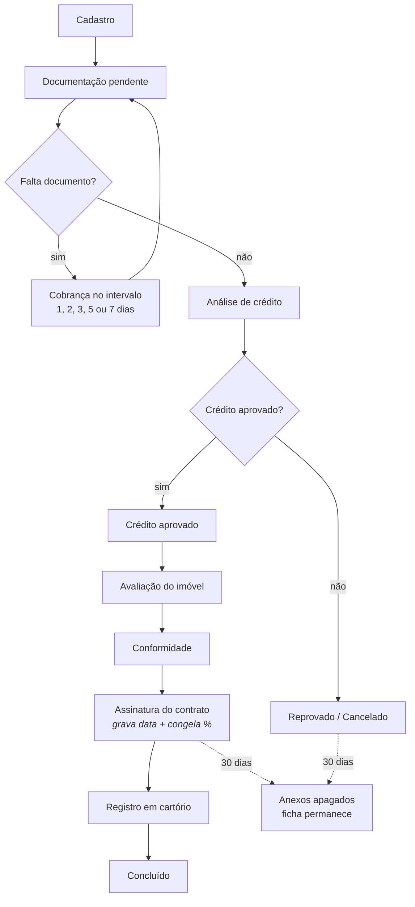
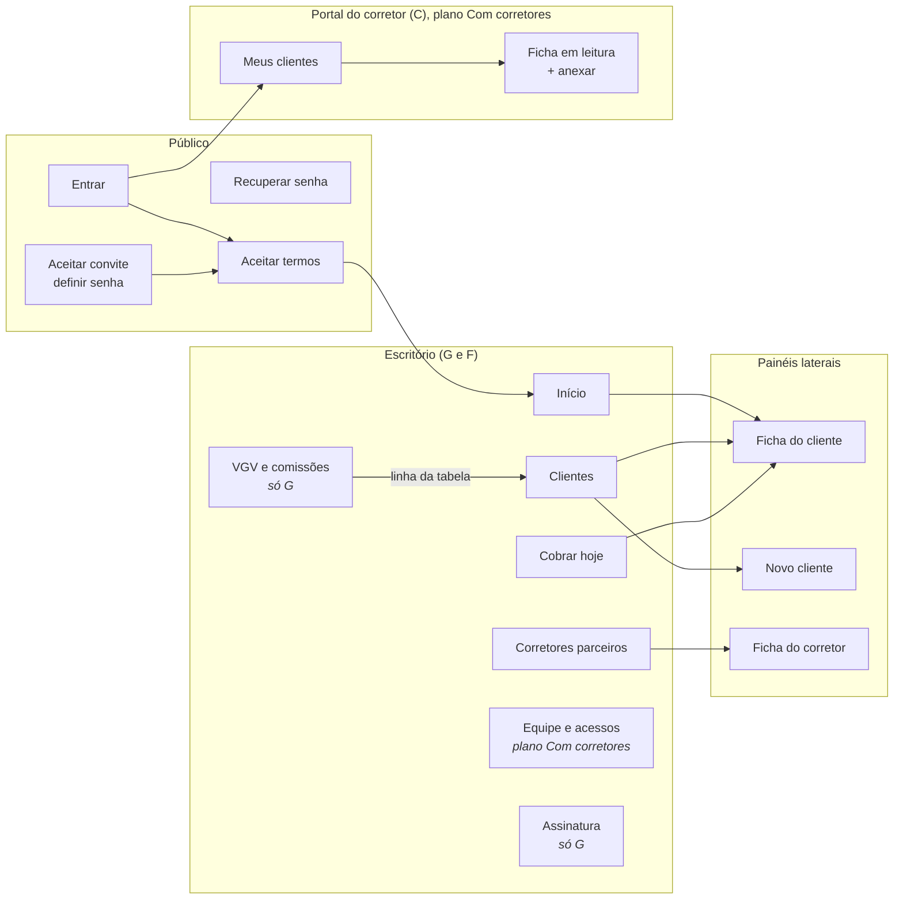
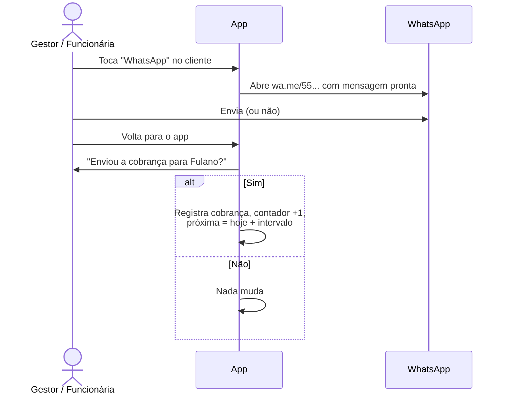
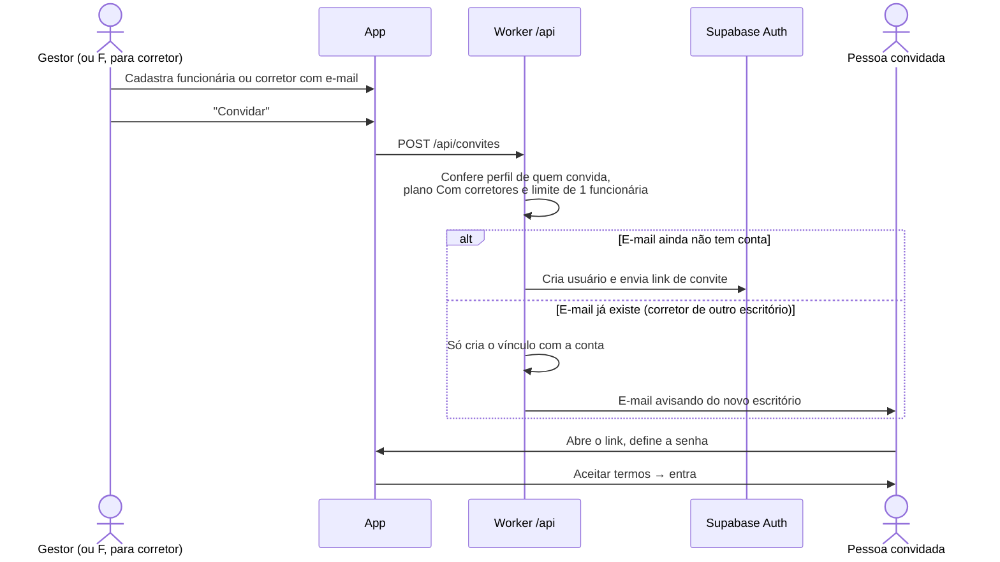
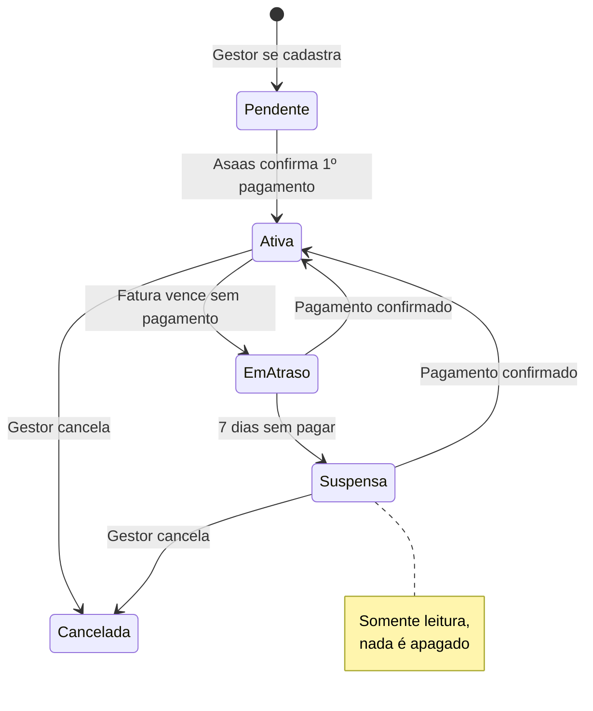

# Fluxos do usuário

Central do Correspondente · versão 0.1 · 13/11/2026

Os diagramas usam Mermaid e aparecem desenhados direto no GitHub.

---

## 1. Jornada do processo

10 etapas, 2 decisões. Enquanto faltar documento, o cliente volta para a lista de cobrança no intervalo escolhido. A assinatura é o ponto em que o app grava a data e congela o percentual.

Qualquer etapa ativa pode ir para Reprovado / Cancelado. Ir direto para Registro em cartório ou Concluído sem data de assinatura grava a data de hoje (RN-06).

---

## 2. Mapa de telas

Início, Clientes e Cobrar hoje abrem a mesma ficha. Quem tem mais de um escritório vê um seletor de escritório logo depois de entrar.

---

## 3. Rotina diária do escritório

1. Às 8h chega o push (ou e-mail) com as cobranças do dia.
2. Abrir **Início** e ver os contadores.
3. Entrar em **Cobrar hoje** e tocar em WhatsApp em cada cliente; ao voltar, confirmar "Enviou?" e o app registra a cobrança e marca a próxima data.
4. Ao receber um documento, abrir a ficha e tocar em **Anexar** no item; ele fica marcado como recebido. (Se o corretor anexou pelo portal, já aparece recebido.)
5. Quando a Caixa der retorno, mudar a etapa na ficha.
6. Ver **Parados há 7+ dias** e anotar no histórico o que foi feito.
7. Uma vez por semana, enviar a mensagem de situação para cada corretor com clientes pendentes.

---

## 4. Cobrança com confirmação

Sem WhatsApp cadastrado, o botão vira "Copiar mensagem" e a mesma pergunta aparece.

---

## 5. Convite de acesso

---

## 6. Corretor acompanha e anexa

1. Corretor entra e cai em **Meus clientes** (só os vinculados a ele).
2. Vê etapa, dias sem atualização e documentos pendentes de cada um.
3. Abre a ficha e toca em **Anexar** no documento que recebeu do cliente.
4. O documento fica recebido, o histórico registra "Anexado por [corretor]" e o processo conta como atualizado.
5. O escritório vê a mudança em tempo real.

---

## 7. Assinatura e inadimplência

Cortesia: o administrador do sistema define o plano e preenche "ativa até"; enquanto a data não passar, a conta é tratada como ativa.

Troca de plano (RF-74): o gestor muda na tela Assinatura e o Worker atualiza o valor no Asaas. Ao voltar para o Simples, funcionária e corretores são desativados antes da troca (nada é apagado). Cobrança da troca: P-11.

---

## 8. Cadastro de escritório novo (proposta P-04)

1. Página de venda → escolhe o plano (Simples ou Com corretores) → "Assinar".
2. Formulário: nome, e-mail, senha, nome do escritório, CPF ou CNPJ (o Asaas exige).
3. Aceite dos termos.
4. Link de pagamento do Asaas.
5. Webhook confirma → conta ativa → gestor entra no Início vazio, com atalho para "Importar do protótipo" e "Cadastrar primeiro cliente".

---

## 9. Exclusão programada de anexos

1. Rotina diária (madrugada) procura clientes com assinatura há 25 dias, ou cancelados há 25 dias, com anexos.
2. Avisa G e F: "Os anexos de Fulano serão apagados em 5 dias."
3. No dia 30, apaga os arquivos do storage, marca os registros como apagados e escreve no histórico.
4. Se a data de assinatura for apagada ou o processo voltar a uma etapa ativa antes disso, nada é apagado (RN-15).
