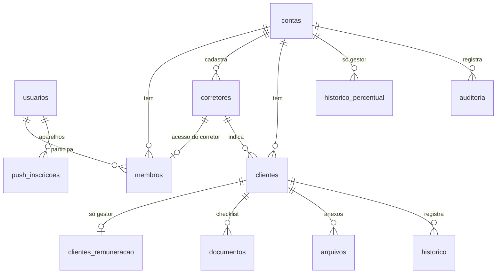

# Modelo de dados

Central do Correspondente · versão 0.1 · 13/11/2026

Postgres (Supabase). Nomes em português, `snake_case`. Valores em `numeric(14,2)`, percentuais em `numeric(6,3)`, datas de negócio em `date`, momentos em `timestamptz`. Todo id é `uuid` (exceto onde indicado).

## 1. Diagrama



## 2. Tipos

```sql
create type perfil as enum ('gestor', 'funcionaria', 'corretor');
create type plano as enum ('simples', 'com_corretores');
create type status_membro as enum ('convidado', 'ativo', 'desativado');
create type status_assinatura as enum ('pendente', 'ativa', 'em_atraso', 'suspensa', 'cancelada');
create type modalidade as enum ('mcmv', 'sbpe', 'pro_cotista', 'outra');
create type etapa as enum (
  'cadastro', 'documentacao_pendente', 'analise_credito', 'credito_aprovado',
  'avaliacao_imovel', 'conformidade', 'assinatura_contrato',
  'registro_cartorio', 'concluido', 'reprovado_cancelado'
);
create type tipo_historico as enum ('nota', 'etapa', 'cobranca', 'documento', 'contrato', 'sistema');
create type acao_auditoria as enum ('ver', 'criar', 'alterar', 'excluir', 'baixar', 'exportar');
```

## 3. Tabelas

### contas
| Campo | Tipo | Nota |
|---|---|---|
| id | uuid pk | |
| nome_escritorio | text not null | |
| documento_titular | text | CPF ou CNPJ para o Asaas |
| plano | plano not null | `simples` (R$ 99) ou `com_corretores` (R$ 149). Muda só pelo Worker |
| percentual_atual | numeric(6,3) | 0 a 100. **Leitura só do gestor** (ver nota em RLS) |
| status_assinatura | status_assinatura | default `pendente` |
| ativa_ate | date | cortesia manual |
| vencimento_em_aberto | date | preenchido pelo webhook quando atrasa |
| asaas_customer_id | text | |
| asaas_subscription_id | text | |
| importado_prototipo_em | timestamptz | impede importar duas vezes |
| criado_em | timestamptz default now() | |

> O percentual atual pode ir para uma tabela própria (`contas_config`) para facilitar a RLS só do gestor. Decidir na fase 1.

### usuarios
Espelho de `auth.users`, criado por gatilho.
| Campo | Tipo | Nota |
|---|---|---|
| id | uuid pk → auth.users | |
| nome | text | |
| email | text | |
| termos_versao | text | |
| termos_aceitos_em | timestamptz | |
| admin_sistema | boolean default false | painel do sistema |
| criado_em | timestamptz | |

### membros
| Campo | Tipo | Nota |
|---|---|---|
| id | uuid pk | |
| conta_id | uuid → contas | |
| usuario_id | uuid → usuarios | |
| perfil | perfil | |
| corretor_id | uuid → corretores null | obrigatório se perfil = corretor |
| status | status_membro | |
| convidado_por | uuid → usuarios | |
| criado_em | timestamptz | |

Restrições:
- `unique (conta_id, usuario_id)`
- índice único parcial `(conta_id) where perfil = 'gestor' and status <> 'desativado'`
- idem para `'funcionaria'`
- `check (perfil <> 'corretor' or corretor_id is not null)`
- gatilho `tg_limite_plano`: em conta `simples`, só aceita o perfil `gestor` (RN-18)

### corretores
| Campo | Tipo |
|---|---|
| id | uuid pk |
| conta_id | uuid → contas |
| nome | text not null |
| imobiliaria | text |
| whatsapp | text (só dígitos) |
| creci | text |
| email | text |
| criado_em, atualizado_em | timestamptz |

### clientes
| Campo | Tipo | Nota |
|---|---|---|
| id | uuid pk | |
| conta_id | uuid → contas | |
| corretor_id | uuid → corretores null | null = cliente direto |
| nome | text not null | |
| cpf | text | 11 dígitos, validado |
| whatsapp | text | só dígitos, validado |
| email | text | validado |
| modalidade | modalidade | |
| etapa | etapa | default `documentacao_pendente` (RF-11) |
| valor_imovel | numeric(14,2) | |
| valor_financiado | numeric(14,2) | |
| valor_avaliacao | numeric(14,2) | |
| entrada | numeric(14,2) | |
| fgts | numeric(14,2) | |
| subsidio | numeric(14,2) | |
| numero_contrato | text | |
| data_assinatura | date | |
| proxima_cobranca | date | default hoje |
| intervalo_cobranca | smallint | default 3, `check in (1,2,3,5,7)` |
| qtd_cobrancas | integer default 0 | |
| ultima_cobranca | timestamptz | |
| observacoes | text | |
| finalizado_em | timestamptz | quando entrou em concluído/cancelado |
| anexos_apagar_em | date | calculado (RN-14) |
| criado_em | timestamptz | |
| atualizado_em | timestamptz | RN-12 |

Índices: `(conta_id, etapa)`, `(conta_id, corretor_id)`, `(conta_id, proxima_cobranca)`, `(conta_id, atualizado_em)`, trigram em `nome` para busca.

### clientes_remuneracao (só gestor)
| Campo | Tipo | Nota |
|---|---|---|
| cliente_id | uuid pk → clientes | |
| conta_id | uuid | |
| pct_contrato | numeric(6,3) | congelado na assinatura (RN-07) |
| pct_proprio | numeric(6,3) | override manual |
| remuneracao_recebida_em | date | RF-56 |

### documentos
| Campo | Tipo | Nota |
|---|---|---|
| id | uuid pk | |
| conta_id, cliente_id | uuid | |
| tipo | text | código de um dos 12 (pendência P-01) |
| recebido_em | date null | null = pendente |
| marcado_por | uuid → usuarios | |

`unique (cliente_id, tipo)`. Os 12 tipos ficam numa tabela fixa `tipos_documento (codigo, nome, grupo, ordem)` para a lista ser igual em todo lugar.

### arquivos
| Campo | Tipo | Nota |
|---|---|---|
| id | uuid pk | |
| conta_id, cliente_id | uuid | |
| tipo_documento | text | código ou `outros` |
| nome | text | nome original |
| caminho | text | `conta_id/cliente_id/id.ext` |
| tamanho | integer | bytes |
| mime | text | |
| enviado_por | uuid → usuarios | |
| enviado_em | timestamptz | |
| apagado_em | timestamptz | RN-14 |

### historico
| Campo | Tipo |
|---|---|
| id | uuid pk |
| conta_id, cliente_id | uuid |
| usuario_id | uuid → usuarios (null = sistema) |
| tipo | tipo_historico |
| texto | text |
| criado_em | timestamptz |

Sem limite de entradas (D-20). Visibilidade para o corretor conforme P-03 (filtro por `tipo`).

### historico_percentual (só gestor)
| Campo | Tipo |
|---|---|
| id | uuid pk |
| conta_id | uuid |
| percentual | numeric(6,3) |
| alterado_por | uuid |
| criado_em | timestamptz |

### auditoria (só inserção; leitura do gestor)
| Campo | Tipo |
|---|---|
| id | bigint identity pk |
| conta_id | uuid |
| usuario_id | uuid |
| acao | acao_auditoria |
| entidade | text (`cliente`, `arquivo`, …) |
| entidade_id | uuid |
| detalhe | jsonb (campos alterados, sem valores sensíveis) |
| criado_em | timestamptz |

### push_inscricoes
| Campo | Tipo |
|---|---|
| id | uuid pk |
| usuario_id | uuid |
| endpoint | text unique |
| chaves | jsonb (p256dh, auth) |
| criado_em | timestamptz |

### eventos_asaas
| Campo | Tipo |
|---|---|
| id | text pk (id do evento) |
| tipo | text |
| conta_id | uuid null |
| payload | jsonb |
| recebido_em | timestamptz |
| processado_em | timestamptz |

## 4. Funções auxiliares (security definer)

```sql
-- perfil do usuário logado na conta (null se não for membro ativo)
meu_perfil(conta uuid) returns perfil
-- corretor_id do usuário logado na conta (null se não for corretor)
meu_corretor_id(conta uuid) returns uuid
-- conta pode receber escrita? (ativa, em_atraso ou ativa_ate >= hoje)
conta_ativa(conta uuid) returns boolean
-- "hoje" no fuso do Brasil
hoje_br() returns date  -- (now() at time zone 'America/Sao_Paulo')::date
```

## 5. Políticas RLS (resumo)

| Tabela | Ler | Gravar |
|---|---|---|
| contas | membro ativo (campos de receita só gestor) | gestor (nome); status e plano só pelo Worker |
| membros | gestor e funcionária da conta; o próprio usuário | só pelo Worker (convites) |
| corretores | gestor, funcionária | gestor, funcionária + `conta_ativa` |
| clientes | gestor, funcionária; corretor onde `corretor_id = meu_corretor_id` | gestor, funcionária + `conta_ativa` |
| clientes_remuneracao | gestor | gestor + `conta_ativa` |
| documentos | como clientes | gestor, funcionária; corretor só via gatilho de anexo |
| arquivos | como clientes | inserir: gestor, funcionária, corretor (próprios); apagar: gestor, funcionária |
| historico | gestor, funcionária; corretor conforme P-03 | inserir: gestor, funcionária; gatilhos |
| historico_percentual | gestor | gatilho ao mudar percentual |
| auditoria | gestor | só gatilhos, RPC e Worker |
| push_inscricoes | o próprio usuário | o próprio usuário |
| eventos_asaas | ninguém | só Worker |

Storage (`documentos`): inserir quando o primeiro segmento do caminho é uma conta em que o usuário pode anexar para aquele cliente; **sem select** para usuários comuns.

## 6. Gatilhos

| Gatilho | Tabela | Faz |
|---|---|---|
| `tg_atualizado_em` | clientes, documentos, arquivos, historico | Atualiza `clientes.atualizado_em` (RN-12) |
| `tg_etapa` | clientes (update de etapa) | Histórico de etapa; RN-06 (data de hoje); `finalizado_em`; recalcula `anexos_apagar_em` (RN-14/15) |
| `tg_assinatura` | clientes (update de data_assinatura) | RN-07 (congela `percentual_atual` em `pct_contrato`); RN-11 (apagar data limpa); histórico tipo `contrato` |
| `tg_anexo_recebido` | arquivos (insert) | Marca o documento como recebido (RF-23) e escreve no histórico com o nome de quem anexou |
| `tg_percentual` | contas (update de percentual_atual) | Insere em `historico_percentual` |
| `tg_auditoria` | clientes, corretores, arquivos, membros | Grava criar/alterar/excluir em `auditoria` |
| `tg_novo_usuario` | auth.users (insert) | Cria a linha em `usuarios` |
| `tg_limite_plano` | membros (insert/update) | Recusa funcionária e corretor, convidados ou ativos, em conta do plano `simples` (RN-18) |

## 7. Views (só gestor)

- `vw_remuneracao`: por cliente, percentual usado (RN-08), remuneração (RN-09), cota (RN-10), contratado (RN-05).
- `vw_vgv_periodo`: VGV contratado por mês.
- `vw_vgv_origem`: contratos, VGV, financiado, remuneração e em andamento por corretor/cliente direto.

Criar as views com `security_invoker = on` para valer a RLS de quem consulta.

## 8. Mapeamento do protótipo (importador)

| Protótipo | Novo |
|---|---|
| `clientes.telefone` | `clientes.whatsapp` |
| `corretorId` | `corretor_id` (via mapa de ids importados) |
| `valorImovel`, `valorFinanciado`, `valorAvaliacao` | `valor_imovel`, `valor_financiado`, `valor_avaliacao` |
| `fgtsUsado` | `fgts` |
| `contrato`, `dataContrato` | `numero_contrato`, `data_assinatura` |
| `pctContrato`, `pctOverride`, `remRecebida` | `clientes_remuneracao.*` |
| `docs` (data por documento) | linhas em `documentos` |
| `arquivos` | **não importados** (arquivos do protótipo precisam ser reenviados, ou importados à parte se o storage do protótipo permitir exportar) |
| `historico` | linhas em `historico` (tipo `nota`) |
| `config/geral.percentual`, `historicoPct` | `contas.percentual_atual`, `historico_percentual` |

Gatilhos de RN-07 e RN-12 ficam desligados durante a importação, para preservar percentuais e datas originais.
